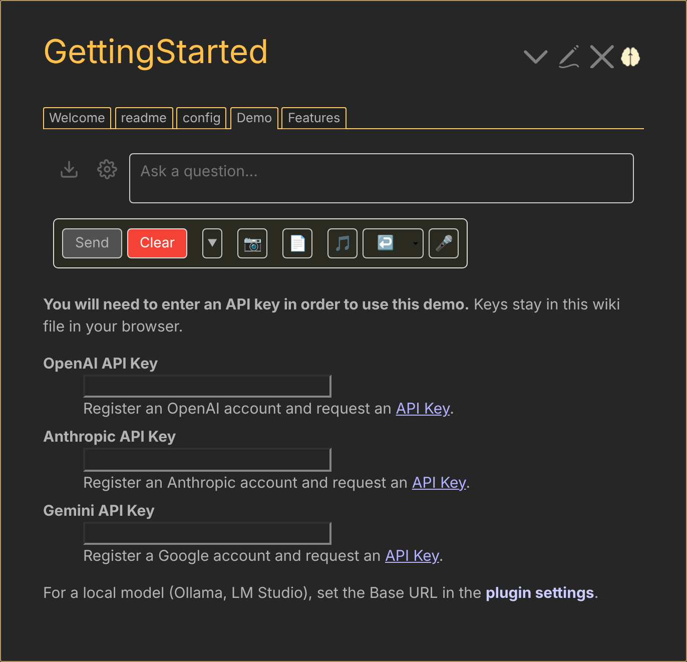
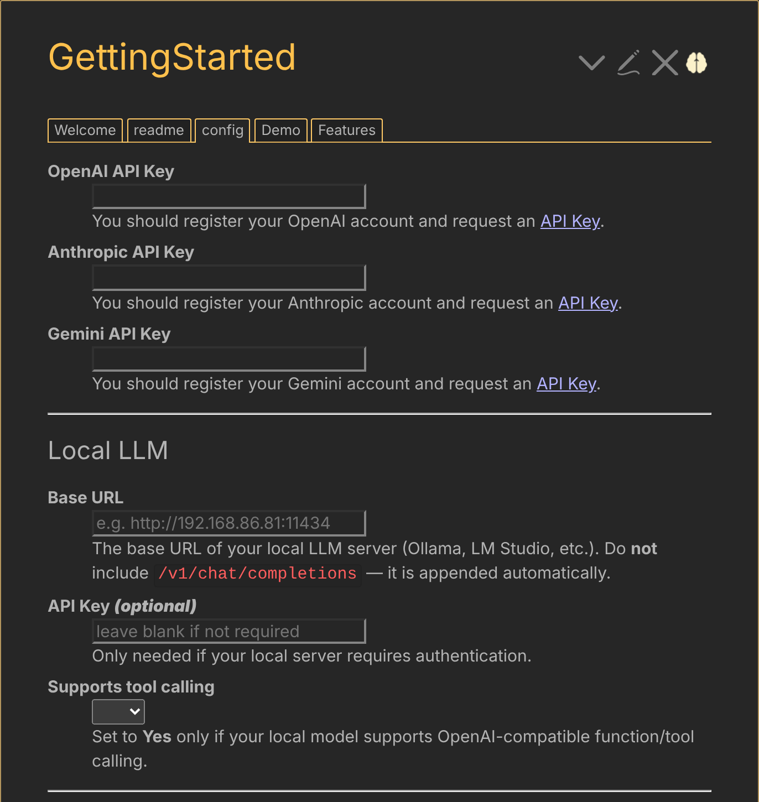
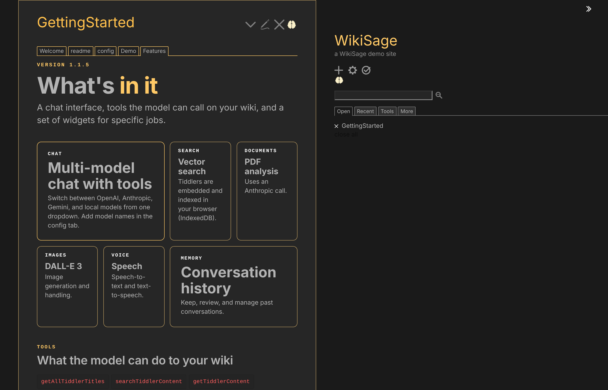

# WikiSage


## Your TiddlyWiki's AI companion

An AI companion plugin for [TiddlyWiki](https://tiddlywiki.com). WikiSage lets a language model read and edit your wiki: it can search your tiddlers, read them, create and modify them, and work from your own notes.

**Version 1.1.5** · requires TiddlyWiki 5.3.5 or later · MIT license

**[Live demo](https://well-noted.github.io/WikiSage/)** · [Discussion on Talk TW](https://talk.tiddlywiki.org/t/wikisage-your-tiddlywiki-ai-companion/11301)

## Chat with a model that knows your wiki



*The chat widget with its toolbar: send, clear, model dropdown, image, PDF, audio, and voice input.*

## Models

- OpenAI (GPT and o-series models, DALL-E 3 for images)
- Anthropic Claude
- Google Gemini
- Local models: any server with an OpenAI-compatible endpoint, such as Ollama or LM Studio. You set the Base URL, an optional API key, and whether the model supports tool calling.

Add model names to the model list in the config tab, one per line. PDF analysis uses an Anthropic call.




## Features

- Chat with a model that has tools for your wiki: list titles; search content, tags, and fields; read content and fields; create, modify, and rename tiddlers; open and close tiddlers; export tiddlers as JSON, CSV, HTML, or TID; read and revise a system reference; undo actions; scrape a web page
- Vector search: tiddlers are embedded and indexed in your browser (IndexedDB), with an action widget for similarity search. Embeddings use an OpenAI-compatible endpoint, `text-embedding-3-small` by default
- PDF analysis
- Image generation (DALL-E 3)
- Voice interaction: speech-to-text and text-to-speech
- Conversation history management
- Smart content editing with macros
- Toggles to show or hide each feature's buttons: main page control, beautify tiddler, auto summary, clarify content, code assist, instruction dropdown, and yadda-yadda

## Everything in one place



## Widgets

| Widget | Purpose |
| --- | --- |
| `<$WikiSage/>` | The chat widget |
| `<$instruction-chatbox/>` | Instruction chat box |
| `<$Notebook-widget/>` | Notebook |
| `<$tiddlywiki-coding-widget/>` | Coding assistant |
| `<$tiddlywiki-journal-widget/>` | Journal |
| `<$tiddlywiki-reference-agent-widget/>` | Reference agent |
| `<$mindmap/>` | Mind map |
| `<$action-vector-search/>` | Similarity search across tiddlers |

## Installation

1. Download `WikiSage.tid` from this repository and drop it onto your TiddlyWiki, then save and reload.
2. Open the plugin's config tab and add the key for each provider you use. The keys are stored in these tiddlers:
   - OpenAI: `$:/plugins/NoteStreams/WikiSage/openai-api-key`
   - Anthropic: `$:/plugins/NoteStreams/WikiSage/anthropic-api-key`
   - Gemini: `$:/plugins/NoteStreams/WikiSage/gemini-api-key`
3. For a local model, set `$:/plugins/NoteStreams/WikiSage/local-llm-url` to the server's base URL (for example `http://localhost:11434`). Do not include `/v1/chat/completions`; it is appended automatically.

Keys are stored in your wiki, so do not publish a wiki that contains them.

## Usage

```
<$WikiSage/>
```

With options:

```
<$WikiSage tiddlerTitle="Context" tts="yes" adversarial="yes"/>
```

Widget attributes: `tiddlerTitle`, `useCurrentTiddler`, `model`, `temperature`, `history`, `tts`, `adversarial`, `readonly`, `scroll`, `className`, `user`.

## Note

The agent has no tool for deleting tiddlers, but it can modify content in ways that may be destructive. Undo handles most problems. Keep backups.

## History

WikiSage continues the [Expanded ChatGPT Interface](https://talk.tiddlywiki.org/t/expanded-chatgpt-interface) plugin, which was inspired by the [ChatGPT for TiddlyWiki](https://talk.tiddlywiki.org/t/chatgpt-for-tiddlywiki/) plugin by Sttot.
